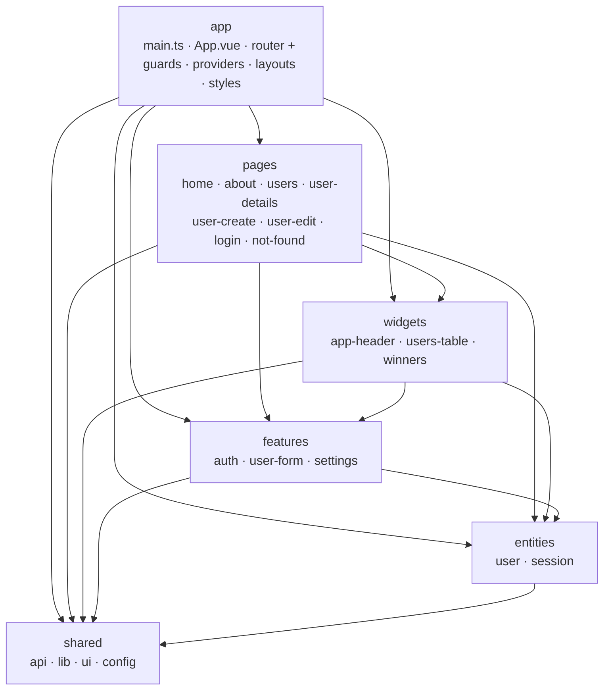

# vue-lottery

SPA для адміністрування лотереї/учасників (Vue 3 + Vite + TypeScript), побудована за методологією Feature-Sliced Design, з бекендом на DummyJSON API та UI-бібліотекою PrimeVue.

## Рекомендоване налаштування IDE

[VS Code](https://code.visualstudio.com/) + [Vue (Official)](https://marketplace.visualstudio.com/items?itemName=Vue.volar) (та вимкніть Vetur).

## Рекомендоване налаштування браузера

- Браузери на основі Chromium (Chrome, Edge, Brave тощо):
  - [Vue.js devtools](https://chromewebstore.google.com/detail/vuejs-devtools/nhdogjmejiglipccpnnnanhbledajbpd)
  - [Увімкніть Custom Object Formatter у Chrome DevTools](http://bit.ly/object-formatters)
- Firefox:
  - [Vue.js devtools](https://addons.mozilla.org/en-US/firefox/addon/vue-js-devtools/)
  - [Увімкніть Custom Object Formatter у Firefox DevTools](https://fxdx.dev/firefox-devtools-custom-object-formatters/)

## Підтримка типів для імпортів `.vue` у TS

TypeScript за замовчуванням не обробляє інформацію про типи для імпортів `.vue`, тому замість CLI-утиліти `tsc` для перевірки типів використовується `vue-tsc`. В редакторах потрібен [Volar](https://marketplace.visualstudio.com/items?itemName=Vue.volar), щоб сервіс TypeScript розумів типи `.vue`.

## Конфігурація

Дивіться [Довідник конфігурації Vite](https://vite.dev/config/).

## Архітектура (FSD)

Шари зверху вниз: `app` → `pages` → `widgets` → `features` → `entities` → `shared`.



Правила, які перевіряє [Steiger](https://github.com/feature-sliced/steiger) (`npm run lint:fsd`):

- шар може імпортувати **лише нижчі шари** — кожна стрілка вище показує дозволений напрямок залежностей; імпорти вгору — це помилки;
- слайси спілкуються між собою **лише через свій `index.ts` (публічний API)** — глибокі імпорти внутрішностей іншого слайса — це помилки;
- компоненти сторінок/віджетів/фіч ніколи не викликають сервіси (`UserService`, `AuthService`) напряму — лише через дії сторів (`useUsersStore`, `useSessionStore`); сервіси прив'язуються у `app/providers/services.ts` до універсального реєстру `ServiceProvider` та споживаються через `ServiceProvider.get(...)`.

## Збереження стану: ручна реалізація проти pinia-plugin-persistedstate

У проєкті використовуються **обидва підходи одночасно**, обрані для кожного слайса окремо:

- `entities/session` → **ручна** реалізація у `session.store.ts`;
- `features/settings` → **pinia-plugin-persistedstate** (підключено у `app/main.ts`: `pinia.use(piniaPluginPersistedstate)`).

| Аспект | Ручна — `session.store.ts` | Плагін — `settings.store.ts` |
| --- | --- | --- |
| Ключі в localStorage | 3 окремі ключі: `lottery-access-token`, `lottery-refresh-token`, `lottery-user` | 1 blob-ключ: `lottery-theme` |
| Що зберігається | Лише вибрані поля (`setSession(tokens, user?)` записує рівно те, що змінилося) | Весь відібраний стан (`pick: ['theme']`) |
| Гідратація | Ручне читання всередині setup стору (`ref(localStorage.getItem(...))`, `readStoredUser()`) | Автоматично при створенні стору |
| Очищення | Явний `clearSession()` видаляє кожен ключ | Видалення цілого ключа (скидання через `persist` / delete) |
| Гранулярність контролю | По-поле: токени можуть поновлюватися незалежно від об'єкта користувача | По-стор: завжди весь зріз стану |
| Обсяг коду | Більше шаблонного коду, явний намір | Майже нуль, декларативна конфігурація |
| Призначення | Стан, чутливий до безпеки, з частковими оновленнями (токени проти користувача) | Маленькі прості налаштування |

Чому сесія ручна: refresh-token-потік перезаписує лише токени (`setSession(tokens)`), тоді як об'єкт користувача записується окремо; роздільні ключі уникають повторної серіалізації та взаємного перезапису/очищення, а один скомпрометований JSON-blob не змішує обидва типи даних. Для малого whole-state налаштування на кшталт теми автоматична гідратація/збереження плагіна — це суворо менше коду.

## Налаштування проєкту

```sh
npm install
```

### Компіляція та hot-reload для розробки

```sh
npm run dev
```

### Перевірка типів, компіляція та мініфікація для продакшену

```sh
npm run build
```

### Лінтинг із [ESLint](https://eslint.org/)

```sh
npm run lint
```
